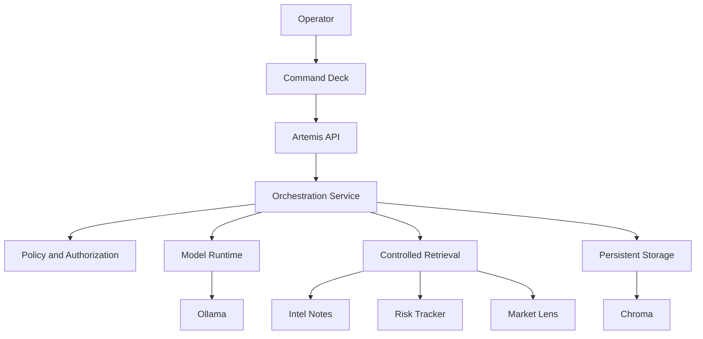
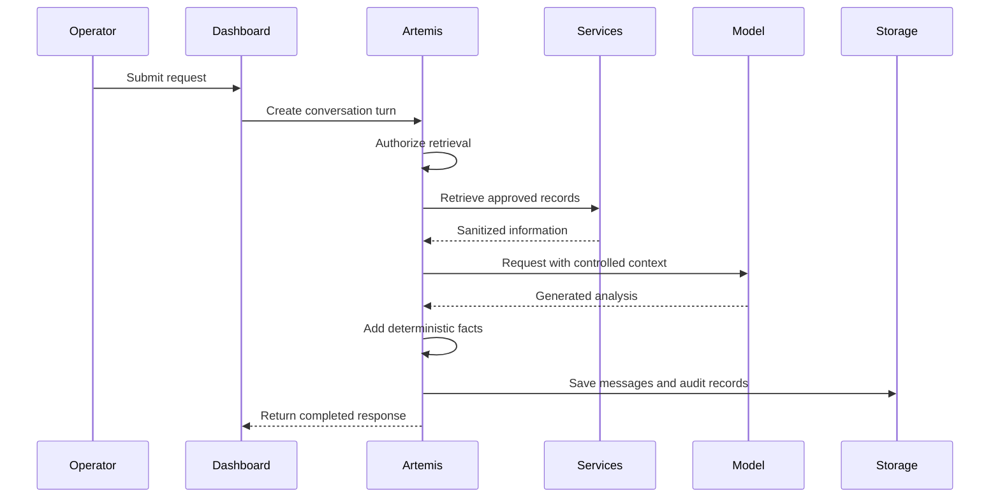

# Artemis Architecture

## Purpose

Artemis is a private, local-first information architecture that coordinates model reasoning, controlled retrieval, persistent storage, governance, and specialized information services.

The language model is one component within Artemis. It does not independently control the platform, connected services, or stored information.

## Design Principles

Artemis is designed around the following principles:

- Local operation by default
- Explicit authorization
- Read-only retrieval where possible
- Clear separation of facts and analysis
- Persistent audit records
- Source-specific controls
- Recoverable operations
- Modular service integration
- Minimal external exposure

## System Overview



## Core Components

### Command Deck

The Command Deck is the browser-based Artemis interface.

It provides:

- Conversation selection
- Message submission
- Controlled retrieval options
- Connected-service health
- Local operating status
- Access to the Artemis API documentation

Static interface files are stored in:

```text
app/static/
```

### FastAPI Application

The FastAPI application is the central entry point for Artemis.

Primary responsibilities include:

- Application lifecycle
- Route registration
- Database initialization
- Security configuration
- Health endpoints
- Static dashboard delivery

Application entry point:

```text
app/main.py
```

### Routes

Routes expose approved application operations.

Current route groups include:

- Conversations
- Preferences
- Approvals
- Application health
- Service health
- Storage health

Route implementations are stored in:

```text
app/routes/
```

### Orchestration

The orchestration service coordinates each conversation turn.

Its responsibilities include:

1. Accepting the user request
2. Evaluating requested retrieval options
3. Calling authorized retrieval services
4. Building supplemental model context
5. Sending the request to the selected model runtime
6. Separating deterministic facts from model analysis
7. Saving the completed messages
8. Recording relevant audit information

Primary implementation:

```text
app/services/orchestration.py
```

### Model Runtime

The runtime layer provides a shared contract for language-model providers.

Current implementations include:

- Ollama runtime for local generation
- Deterministic runtime for testing

Runtime files are stored in:

```text
app/runtime/
```

The default model configuration is:

```text
Provider: Ollama
Model: qwen3:8b
Temperature: 0.2
Maximum output tokens: 2048
```

### Controlled Retrieval

Connected information is retrieved through dedicated connectors and service-specific retrieval logic.

Current integrations include:

- Intel Notes Manager
- Protective Intelligence Risk Tracker
- Market Lens

Connectors are stored in:

```text
app/connectors/
```

Retrieval services are stored in:

```text
app/services/
```

Retrieval controls include:

- Field allowlists
- Record-count limits
- Context-length limits
- Input sanitization
- Read-only credentials
- Source-specific authorization
- Missing-service handling
- Audit recording

Retrieved content is treated as untrusted reference data rather than executable instructions.

### Deterministic Facts

Market Lens retrieval includes deterministic fact generation.

The application produces the retrieved facts directly from sanitized records before displaying the model’s analysis.

This prevents the language model from rewriting exact:

- Record counts
- Asset fields
- Dates
- Prices
- Calculated analytics
- Signal counts

Primary implementation:

```text
app/services/market_facts.py
```

### Policy and Authorization

The governance layer determines whether an operation is permitted.

It supports:

- Operation authorization
- Source-specific access rules
- Approval requirements
- Denied-operation handling
- Audit records

Primary implementations:

```text
app/services/policy.py
app/services/authorization.py
app/services/approvals.py
app/services/audit.py
```

### Persistent Storage

Artemis stores application records such as:

- Conversations
- Messages
- Preferences
- Approvals
- Identities
- Audit events
- Application lifecycle events

Database configuration is located in:

```text
app/database.py
app/models.py
```

Chroma provides local semantic-memory infrastructure and persists its data under:

```text
data/chroma/
```

## Service Topology

| Service | Address | Role |
|---|---|---|
| Artemis | `127.0.0.1:8200` | Core platform |
| Ollama | `127.0.0.1:11434` | Local model runtime |
| Chroma | `127.0.0.1:8100` | Semantic memory |
| Intel Notes | `127.0.0.1:8001` | Recorded information |
| Risk Tracker | `127.0.0.1:8000` | Case and risk records |
| Market Lens | `127.0.0.1:8003` | Market information |
| Odysseus | `127.0.0.1:7000` | Transitional workspace |

All standard service addresses use the local loopback interface.

## Conversation Data Flow



## Trust Boundaries

Artemis maintains several important trust boundaries.

### Operator Input

User input is treated as a request, not automatic authorization.

### Retrieved Information

Retrieved fields are treated as untrusted reference data and cannot override system instructions.

### Model Output

Generated model content is treated as analysis and is not accepted as proof that an external action occurred.

### Connected Services

Connectors use narrowly scoped retrieval operations and read-only credentials where supported.

### External Network

External access is disabled by default. Artemis and its connected services use localhost addresses.

## Security Defaults

```text
HOST=127.0.0.1
EXTERNAL_ACCESS_ENABLED=false
TELEMETRY_ENABLED=false
```

Artemis should not be exposed to an external network without:

- Authentication
- Authorization review
- TLS encryption
- Network filtering
- Credential rotation
- Rate limiting
- Security logging
- Deployment hardening
- Formal testing

## Lifecycle Management

The launcher controls normal startup and shutdown.

```text
scripts/Start-Artemis.ps1
scripts/Stop-Artemis.ps1
```

The launcher:

- Detects already-running services
- Starts missing services
- Waits for readiness
- Records managed process identifiers
- Opens the Command Deck

The shutdown script stops only processes recorded as launcher-managed.

## Current Boundary

Version `v0.1.0` establishes the Artemis platform foundation.

It does not yet provide a general collection engine, Source Registry, universal information-record schema, scheduled watchlists, or automated reporting pipeline.

Those capabilities belong to the next development stage.